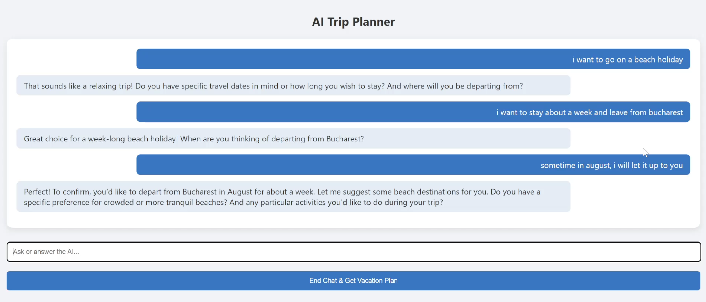
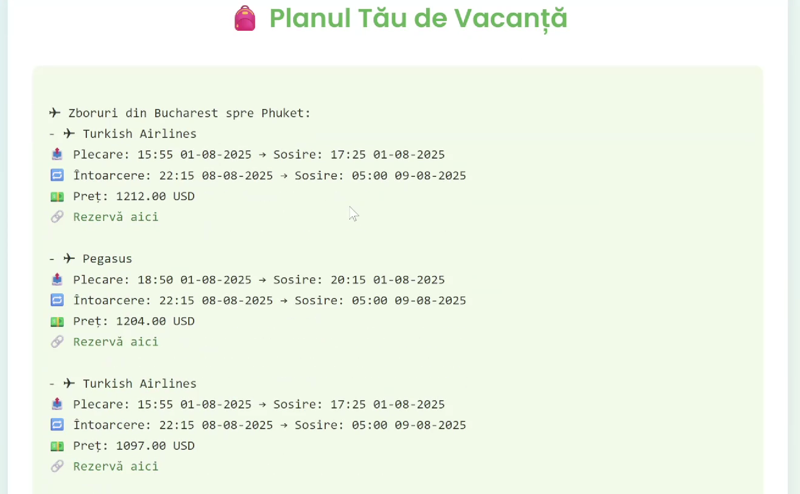

# 🌍 AI Trip Planner

**AI Trip Planner** is an AI-powered web application that helps users plan personalized vacations through a conversational interface.

Built with **Python and Django**, the application uses OpenAI to understand travel preferences and integrates external travel services to recommend flights, hotels, and tourist attractions.

The project was originally developed as a university assignment and later updated with modern API integrations.

## ✨ Features

### 💬 AI-Powered Travel Assistant

Users interact with an OpenAI-powered chatbot to describe their ideal vacation.

The chatbot collects information such as:

- Departure location and preferred destination
- Travel dates and duration
- Budget and personal interests
- Travel preferences

After the conversation, the application extracts structured travel information from the user's messages.



### 🧳 Personalized Vacation Plan

Once the conversation is complete, the application generates a vacation plan by combining information from three travel services:

- **✈️ Flights — Kiwi.com:** Up to 3 round-trip flight options, including prices, airlines, schedules, and booking links.
- **🏨 Hotels — Booking:** Up to 3 accommodation recommendations for the selected destination and dates.
- **🏛️ Attractions — Tripadvisor:** Up to 5 tourist attractions with categories, ratings, and links.

All recommendations are displayed together on a dedicated results page.



## 🛠️ Tech Stack

| Component       | Technology                                |
| --------------- | ----------------------------------------- |
| Backend         | Python 3.11, Django 5.2                   |
| Frontend        | HTML, CSS, JavaScript                     |
| AI Chatbot      | OpenAI API                                |
| Flight Search   | Kiwi.com MCP                              |
| Hotels          | Booking API (RapidAPI)                    |
| Attractions     | Tripadvisor Travel Advisor API (RapidAPI) |
| Data Storage    | JSON, SQLite                              |
| Other Libraries | Requests, Pandas, python-dotenv, MCP SDK  |

## ⚙️ How It Works

The application follows a modular architecture that separates the chatbot, travel-planning logic, and external API integrations.

```text
User
  |
  v
Django Chat Interface
  |
  v
OpenAI Chatbot
  |
  v
Travel Preferences Extraction
  |
  v
JSON Data Storage
  |
  v
Vacation Planner
  |
  +----> Kiwi.com MCP --------> Flights
  |
  +----> Booking API ---------> Hotels
  |
  +----> Tripadvisor API -----> Attractions
  |
  v
Generated Vacation Plan
```

### Implementation Details

- **`core/gpt_UserChat/views.py`** — Handles chatbot requests, OpenAI communication, and preference extraction.
- **`core/planner/vacation_planner.py`** — Coordinates the travel services and generates the vacation plan.
- **`core/planner/flights.py`** — Uses the official Kiwi.com MCP server to search for round-trip flights.
- **`core/planner/hotels.py`** — Retrieves accommodation recommendations through Booking API.
- **`core/planner/activities.py`** — Retrieves tourist attractions through Tripadvisor Travel Advisor API.

The chatbot extracts travel preferences into JSON, which is subsequently used by the vacation planner to retrieve personalized recommendations.

## 🚀 Getting Started

### Prerequisites

- Python 3.11
- Git
- OpenAI API key
- RapidAPI account with access to Booking and Travel Advisor APIs

### 1. Clone the Repository

```bash
git clone <REPOSITORY_URL>
cd AI-Trip-Planner
```

Replace `<REPOSITORY_URL>` with the GitHub repository URL.

### 2. Create a Virtual Environment

**Windows (PowerShell):**

```powershell
py -3.11 -m venv .venv
.\.venv\Scripts\Activate.ps1
```

**macOS / Linux:**

```bash
python3.11 -m venv .venv
source .venv/bin/activate
```

### 3. Install Dependencies

```bash
python -m pip install -r requirements.txt
```

> The project was tested on Windows with Python 3.11.9. Platform-specific dependencies may need adjustments on macOS or Linux.

### 4. Configure Environment Variables

Create a `.env` file in the project root, next to `manage.py`:

```dotenv
OPENAI_API_KEY=your_openai_api_key

RAPIDAPI_KEY=your_rapidapi_key
RAPIDAPI_HOST_BOOKING=apidojo-booking-v1.p.rapidapi.com
RAPIDAPI_HOST_TRIPADVISOR=travel-advisor.p.rapidapi.com
```

**API setup:**

- [OpenAI Platform](https://platform.openai.com/api-keys) — Create an API key and configure billing if required.
- [Booking API](https://rapidapi.com/apidojo/api/booking) — Enable access through RapidAPI.
- [Travel Advisor API](https://rapidapi.com/apidojo/api/travel-advisor) — Enable access through RapidAPI.
- [Kiwi.com MCP](https://mcp.kiwi.com) — Used directly through the MCP SDK, without an additional RapidAPI key.

The OpenAI model must be available to your API account. RapidAPI services may have subscription requirements or usage limits.

**Never commit your `.env` file or API keys to GitHub.**

### 5. Run the Application

Apply database migrations:

```bash
python manage.py migrate
```

Start the Django development server:

```bash
python manage.py runserver
```

Open the chatbot in your browser:

**http://127.0.0.1:8000/chat/**

## 🧪 Example Usage

1. Open the chatbot interface.
2. Describe your travel preferences.
3. Answer any follow-up questions and confirm your destination.
4. Click **End Chat & Get Vacation Plan**.
5. Explore the generated flight, hotel, and attraction recommendations.

**Example prompt:**

> I want to plan a 5-night trip from Bucharest, Romania, to Rome, Italy, from February 15 to February 20, 2027. I'm interested in history, museums, architecture, and Italian food.

The application processes the conversation and displays the results at:

`http://127.0.0.1:8000/chat/vacation_plan/`

Use future travel dates when testing the application.

## 📌 Limitations & Future Improvements

This project is an educational prototype designed for local development and demonstration.

Current limitations:

- No user authentication or individual accounts.
- Travel preferences are stored locally in JSON files.
- Flight searches currently use one adult passenger.
- Recommendations depend on third-party APIs and their availability.
- Bookings and payments are completed on external websites.

Potential improvements include user authentication, database-backed travel plans, saved itineraries, budget filtering, and production deployment.

## 📚 Project Background

AI Trip Planner was developed as a university project to explore the integration of **conversational AI and external travel APIs**.

The project demonstrates backend development with Django, AI integration using OpenAI, API communication, structured data processing, and modular application design.

The original implementation was subsequently updated to use newer Booking and Tripadvisor endpoints and the official Kiwi.com MCP integration.

Additional resources:

- [UML Architecture Diagram](./Diagrama%20UML.png)
- [Original Project Demo](./demo-final.mkv)

## ⚠️ Disclaimer

AI Trip Planner is an educational application. Flight prices, accommodation availability, and attraction information may change.

The application does not perform reservations or process payments. Users should verify all details with the relevant providers before booking.
